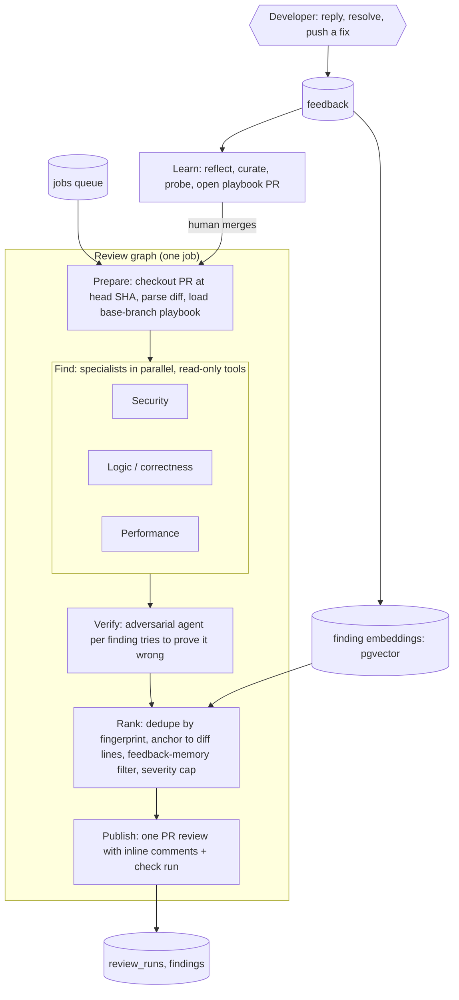

# GitGoblin roadmap

**North star:** a PR reviewer whose comments developers act on. Every finding is anchored to a real line, verified against the code before it's posted, and the reviewer gets quieter and sharper per repo from human feedback.

**Where we are (Nov 2026):** PR #1 merged. Webhooks are acknowledged in ~25 ms and queued in Postgres; a worker runs reviews with leases, retries, and graceful shutdown. Reviews themselves are still two prompt-only specialists that read the raw diff and post one Markdown comment.

---

## 1. Research that shapes this plan

| Finding | Source | What we take from it |
|---|---|---|
| Anthropic's Code Review runs in four stages: **Find** (several agents read the diff *and surrounding code* in parallel), **Verify** (candidate findings are checked against the code; false positives dropped), **Rank** (dedupe + severity), **Post** (inline comments, summary, check run) | [Claude Code docs: Code Review](https://code.claude.com/docs/en/code-review) | Our pipeline shape |
| It reads `REVIEW.md` "from the base or default branch and **never from the pull request's own changes**"; repo access is read-only; it doesn't build or run code | same | Our prompt-injection rule and tool permissions |
| Internally: substantive review comments went from 16% to 54% of PRs; <1% of findings marked incorrect; ~20 min and $15–25 per review on average | [The New Stack, Mar 2026](https://thenewstack.io/anthropic-launches-a-multi-agent-code-review-tool-for-claude-code/) | Verification works but is expensive: we need review levels and budgets |
| Focus on logic bugs, not style, "because people are very sensitive to false positives" | same | Default scope: correctness and security; style off |
| Claude Code doesn't index code: it "traverses the file system, reads files, uses grep… and follows references". Embedding pipelines go stale ("returns a function the team renamed two weeks ago"). Tradeoff: agentic search needs good starting context; LSP gives symbol-level precision | [Claude: How Claude Code works in large codebases](https://claude.com/resources/articles/how-claude-code-works-in-large-codebases-best-practices-and-where-to-start) | Code context = tools over a checkout first; vectors only if they beat it |
| Greptile: prompt engineering and an **LLM judge rating severity 1–10 ("nearly random")** both failed to cut nits. What worked: embed each comment, store with team feedback, **block a new comment similar to ≥3 downvoted ones**. Address rate 19% → 55%+ in two weeks | [Greptile via ZenML case study](https://www.zenml.io/llmops-database/improving-ai-code-review-bot-comment-quality-through-vector-embeddings) | Vectors pay off most as **feedback memory**; a verifier must check evidence, not grade vibes |
| Multi-agent systems use ~15× the tokens of a chat; agents ~4×. Token usage explains 80% of performance variance in their eval | [Anthropic: multi-agent research system](https://www.anthropic.com/engineering/multi-agent-research-system) | Multi-agent only where it buys accuracy; budget every agent |
| ACE (evolving playbooks), closed-loop behavioral rules, Harness² (propose–probe–compose) | see `docs/learning/…` and earlier design notes | The learning loop (M6) |

---

## 2. Target architecture



### 2.1 Find: specialists with tools (multi-agent)

Today each specialist sees only the diff. Next, each gets **read-only tools** over a shallow clone at the PR's head commit:

| Tool | Backed by | Why |
|---|---|---|
| `read_file(path, start, end)` | the checkout | See the code around a change |
| `grep(pattern, path_glob)` | ripgrep | Find callers, config, other uses |
| `find_definition` / `find_references(symbol)` | tree-sitter symbol index (later: an LSP) | Symbol-level precision instead of text matches |
| `semantic_search(query)` | pgvector code index (**optional, M7**) | Only if evals show it finds what grep misses |

Output is structured, not Markdown: `Finding{id, specialist, category, severity, path, line_start, line_end, claim, evidence, suggestion, confidence}`. Every finding must name the lines it's about.

### 2.2 Verify: "another agent tries to prove it wrong"

A **separate agent with its own context** receives one finding at a time: the claim, the location, and the same read-only tools. It does **not** see the finder's reasoning.

```
 Finder:   "SQL injection at queue.py:42: user input reaches execute()"
 Verifier: task = find evidence this is FALSE
           → reads queue.py:30–60, greps for the sanitizer, follows the caller
           → verdict: refuted | confirmed | unproven, plus quoted lines as evidence
 Rank:     refuted → drop   confirmed → keep   unproven → keep only if severity ≥ high
```

Why this differs from Greptile's failed judge: it doesn't ask "how severe is this, 1–10?". It asks a falsifiable question and requires quoted code as proof. Extra confidence signal: two specialists independently reporting the same fingerprint.

### 2.3 Rank and publish

- **Fingerprint** = hash(specialist, path, category, normalized claim) → dedupe within a run and across pushes.
- **Anchor check:** drop any finding whose lines aren't in the diff (GitHub rejects those comments anyway).
- **Feedback-memory filter** (M5): block findings similar to ≥3 rejected findings in this repo (Greptile rule).
- **Severity cap:** at most N comments per review; the rest go in the summary.
- **Publish once:** one GitHub review per `(repo, PR, head SHA)` with a hidden marker, which also fixes the duplicate-comment gap from PR #1.

### 2.4 "Vectorizing the codebase": the decision

There are two different uses of embeddings, and they're worth very different amounts:

| Use | Value | Plan |
|---|---|---|
| **Feedback memory:** embeddings of past findings + verdicts, per repo | High; proven (19% → 55%+ address rate) | **Build (M5)** |
| **Code search index:** embeddings of code chunks | Unproven for review; staleness is the known failure mode | **Experiment (M7)**, kept only if it improves eval recall |

If we build the code index, avoid staleness by design:
- Chunk with **tree-sitter** by function/class, not by line count.
- Key every chunk by its **git blob SHA** (the content hash of the file). Unchanged files reuse existing embeddings across commits; only changed blobs are re-embedded. The index for a PR is just "all blobs at its head SHA", so it can never show a renamed or deleted function.
- Store in **pgvector** in the same Postgres: no second database, and queries filter by repo with plain SQL.

### 2.5 Budgets and review levels

| Level | Specialists | Verify | Tool calls per agent | Default for |
|---|---|---|---|---|
| Quick | 1 combined | High severity only | 5 | Small PRs, synchronize pushes |
| Standard | 3 | All findings | 15 | Default |
| Deep | 3 + cross-file | All + second opinion | 40 | Requested via `@gitgoblin-dev review deep` |

Hard limits per job: total tokens, wall time (the lease heartbeat already supports long jobs), and diff size. Cost per run is recorded on `review_runs`.

### 2.6 Safety

- The diff and repo contents are **untrusted input** (prompt injection via comments or files). Instructions come only from our prompts and the **base-branch** playbook.
- Tools are read-only; no code is executed; clones are size-limited and deleted after the job.
- Only feedback from `OWNER` / `MEMBER` / `COLLABORATOR` trains anything.

---

## 3. Data model additions

| Table | Key columns | Milestone |
|---|---|---|
| `review_runs` | repo, pr, **head_sha (unique together)**, level, harness_version, status, tokens, cost, timings | M2 |
| `findings` | run_id, fingerprint, specialist, severity, path, lines, claim, evidence, verdict, verifier_evidence, github_comment_id, status | M2, verdict in M4 |
| `feedback` | finding_id, source, verdict, actor, author_association, text | M5 |
| `finding_embeddings` | finding_id, repo, embedding `vector`, verdict | M5 |
| `lessons` | repo, finding_ids, lesson, proposed_delta, playbook_pr | M6 |
| `code_chunks` | repo, **blob_sha**, path, symbol, start/end line, embedding `vector` | M7 (experiment) |

---

## 4. Milestones

Evals come early on purpose: every later milestone has to prove it helped.

| # | Milestone | Done when |
|---|---|---|
| **M2** | **Structured findings + one review per commit.** `Finding` schema, inline review comments, `review_runs` unique on head SHA, supersede older pushes, graph runner, **eval set v0** (10–20 real PR diffs with known issues) | A push yields one GitHub review with anchored inline comments; a crash-retry or double push never posts twice; `gitgoblin eval` prints precision/recall per specialist |
| **M3** | **Repo context for finders.** Shallow clone at head SHA + `read_file`, `grep`, tree-sitter `find_definition`/`find_references` | Eval recall improves on cross-file bugs vs diff-only, at a recorded token cost |
| **M4** | **Verifier.** Adversarial per-finding agent with the same tools; verdicts + evidence stored | On the eval set, false positives drop with ≤ small recall loss; each posted finding shows its evidence |
| **M5** | **Feedback capture + feedback memory.** Replies, resolved threads, follow-up fixes → `feedback`; pgvector similarity filter | Address rate tracked per repo; a finding similar to ≥3 rejected ones is suppressed |
| **M6** | **Learning loop.** Reflect → curate → probe on recent PRs → playbook PR with before/after evidence | A rejected class of finding becomes a playbook rule via a merged PR, and stops recurring |
| **M7** | **Code index experiment.** tree-sitter chunks keyed by blob SHA in pgvector, exposed as `semantic_search` | Kept only if eval recall rises enough to justify the cost; otherwise removed |

### Carried over from PR #1 (do during M2)
- First real model run (`LLM_API_KEY`), then measure review time and GLM's concurrency limit.
- Deploy (Fly/Railway) and point the GitHub App webhook at it; disconnect Vercel.
- Typed job payloads, a `JobStatus` enum, shared logging setup (PR #1 standards review).
- Wait ≥ 60 s after GitHub secondary rate limits; reuse installation tokens.

---

## 5. Open decisions

| Decision | Options | Note |
|---|---|---|
| Model for finders vs verifier | Same GLM model / a stronger model for verify | Multi-agent is ~15× tokens; GLM Coding Plan concurrency is unpublished and its policy limits use to supported tools |
| Embedding model | To choose when M5 starts | Must be callable from the worker; dimension fixes the `vector(n)` column |
| Graph runtime | Hand-rolled (chosen) | Revisit only if checkpointing or tracing becomes painful |
| Where clones live | Worker's local disk, deleted after each job | Needs a disk size limit per job |
